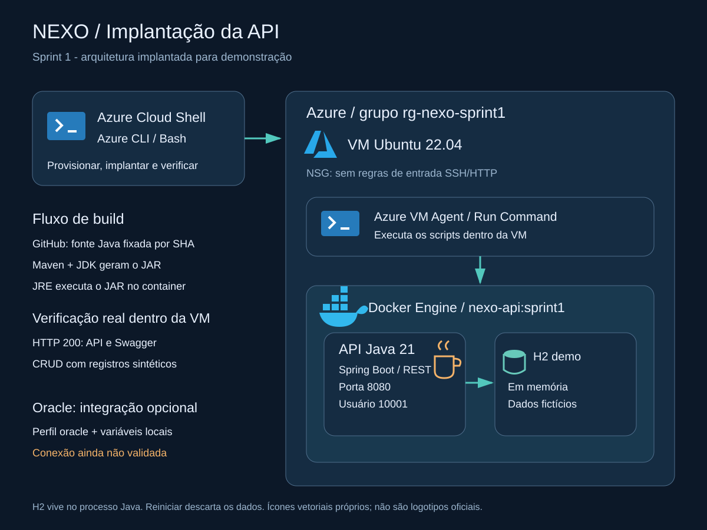

# NEXO — DevOps

Sprint 1 de DevOps Tools & Cloud Computing, FIAP / Challenge AMAZUL.

Esta parte do NEXO coloca a API Java do grupo em um container Docker dentro de uma
VM Ubuntu na Azure. A demonstração usa H2 em memória, com dados fictícios.
A integração com Oracle fica para uma próxima etapa.

## Entrega da Sprint 1

- **Vídeo da demonstração:** [assistir no YouTube](https://www.youtube.com/watch?v=YWLDkvy1bto).
- **PDF da entrega:** [NEXO-DevOps-Entrega-Final.pdf](delivery/NEXO-DevOps-Entrega-Final.pdf).
- **Exclusão da Azure:** [comprovante e registro](evidence/README.md#exclusão-dos-recursos).

A implantação foi testada na Azure em 02 e 03/11/2026. Após a gravação, o grupo
`rg-nexo-sprint1` foi excluído em **03/11/2026**. A VM não está mais disponível;
os resultados abaixo registram a execução antes da exclusão.

## O que foi validado

- Imagem Docker construída e container executado na VM Azure.
- Swagger e endpoints da API respondendo normalmente.
- Cadastro, consulta, atualização, validação e exclusão testados, inclusive após reiniciar o container.
- Build Docker e testes HTTP/CRUD aprovados no GitHub Actions.

Os resultados estão em [validação](docs/validacao.md). O código e a documentação
estão na branch `main`, após a integração do
[PR #2](https://github.com/Nexo-Challenge/s1-devops-cloud/pull/2).

## Como rodar

| O que você precisa | Onde encontrar |
| --- | --- |
| Rodar no computador com Docker | [Passo a passo Docker](docker/README.md) |
| Criar e testar a VM | [Passo a passo Azure](azure/README.md) |
| Entender a estrutura | [Arquitetura](docs/arquitetura/README.md) |
| Acessar vídeo e PDF | [Entrega final](delivery/README.md) |
| Conferir os itens da disciplina | [Checklist da Sprint 1](docs/requisitos-sprint-1.md) |

## Por que Docker e Azure?

O Docker reúne a API, o Java e as configurações em uma imagem que pode ser executada
em outras máquinas. O Dockerfile usa Maven para gerar o JAR e uma segunda etapa,
com JRE, para rodar a aplicação com um usuário sem privilégios de administrador.

A Azure fornece a VM, o disco e a rede para hospedar esse container. Os scripts
usam Azure CLI para criar e administrar o ambiente. Nesta demonstração, os testes
rodam dentro da VM por Run Command: o endereço `127.0.0.1:8080` é da VM, e a API
não está aberta para acesso pela internet.

## Equipe

Turma **2TDSPS**.

| Integrante | RM | Responsabilidade |
| --- | --- | --- |
| Alisson Kawan Evangelista Silva | 567598 | Java e .NET |
| Kenji Fernandes Wakabayashi | 568156 | IoT e Banco de Dados |
| Erick Ramos Santos | 567837 | DevOps Tools & Cloud Computing |
| Eduardo Boni dos Santos | 567236 | Mobile Application Development |
| Marcos Vinicius de Jesus Almeida | 567214 | Documentação e Qualidade de Software |

Nomes e RMs conferidos nos repositórios de
[banco de dados](https://github.com/Nexo-Challenge/s1-database#equipe-e-responsabilidade)
e [mobile](https://github.com/Nexo-Challenge/s1-mobile-flutter#equipe-e-responsabilidade).

## Sobre esta versão

A API vem do [s1-java-api](https://github.com/Nexo-Challenge/s1-java-api), no commit
`b277672b3ed25ac2bd2970fbd6824dc3d38bae86`, sem mudanças no código Java.
O build usa Java 21 e Maven 3.9.11. As versões e os resultados completos estão na
[validação](docs/validacao.md).

O banco H2 perde os dados ao reiniciar. A conexão Oracle ainda não foi testada.
Os recursos da implantação foram excluídos depois da gravação. Os comandos de
criação permanecem disponíveis para reproduzir o ambiente em outra assinatura.
