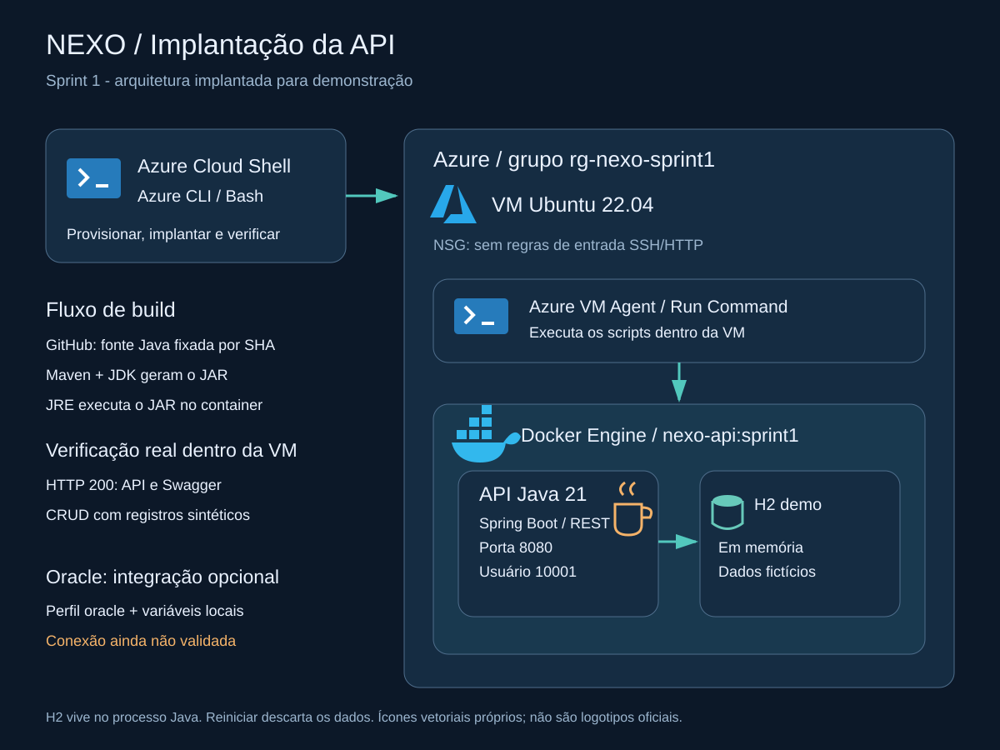

# Arquitetura

O Cloud Shell executa a Azure CLI, que cria e administra a VM Ubuntu.
Dentro da VM, o Docker roda a API Java 21 com Spring Boot. No modo demo,
o H2 fica na memória do próprio processo Java, com dados fictícios.

## Como os testes chegam à API

O Run Command usa o Azure VM Agent para executar os scripts dentro da VM.
A API atende em `127.0.0.1:8080`, e o NSG não libera entrada HTTP ou SSH.
Assim, a demonstração acontece no terminal da VM, sem expor o CRUD à internet.

## Imagem e banco

O Dockerfile tem duas etapas: Maven/JDK para compilar e JRE para executar o JAR.
`scripts/build-image.sh` busca um commit fixo da API. Os IDs da imagem validada
estão em [validação](../validacao.md), já que as tags das imagens base podem receber atualizações.

O H2 perde os dados ao reiniciar. O perfil Oracle usa variáveis de ambiente e
depende do schema, das permissões e da conexão com o servidor do grupo.
Essa integração ainda precisa ser testada; os scripts não criam tabelas Oracle.

Arquivos do diagrama: [SVG](arquitetura.svg) e [PNG](arquitetura.png).
