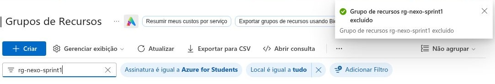

# Evidências da Sprint 1

## Demonstração e testes

- [Vídeo no YouTube](https://www.youtube.com/watch?v=YWLDkvy1bto): arquitetura, scripts de provisionamento, Dockerfile, container e testes na VM Azure.
- [Resumo da execução na Azure](validacao-azure.txt): registro da saída conferida no terminal.
- [Resultados e limites dos testes](../docs/validacao.md).
- [GitHub Actions aprovado](https://github.com/Nexo-Challenge/s1-devops-cloud/actions/runs/41567058770): build Docker e testes HTTP/CRUD, sem implantação na Azure.
- [PDF da entrega](../delivery/NEXO-DevOps-Entrega-Final.pdf).

Os logs brutos foram gerados no Cloud Shell, mas o download pela interface falhou.
O arquivo de texto é um resumo, não um log bruto.

## Exclusão dos recursos

Em **03/11/2026**, depois da gravação, o grupo `rg-nexo-sprint1` foi excluído pelo
portal Azure. O portal exibiu **“Grupo de recursos rg-nexo-sprint1 excluído”** e a
busca pelo nome do grupo retornou zero resultados.

A exclusão incluiu a VM, o disco, o IP público, a interface de rede, a rede virtual,
o grupo de segurança e o agendamento de desligamento. Nenhum recurso de outros
grupos foi excluído nessa operação.

No vídeo, a primeira tentativa de limpeza aparece como `Cancelado` por erro no
texto de confirmação. A imagem acima registra a exclusão concluída depois da
gravação. A confirmação foi obtida pelo portal; não há neste repositório uma saída
posterior do comando `az group exists`.

A captura foi recortada para mostrar o resultado sem dados da conta. As evidências
públicas não contêm senhas, tokens, chaves ou identificadores da assinatura.
